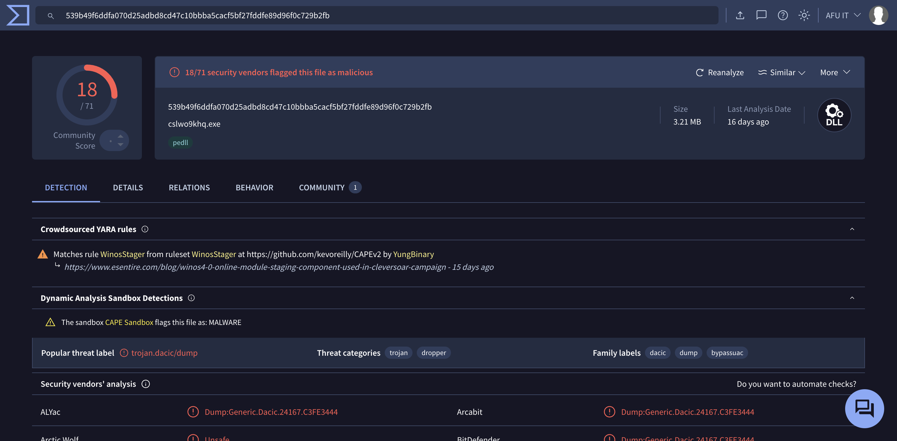
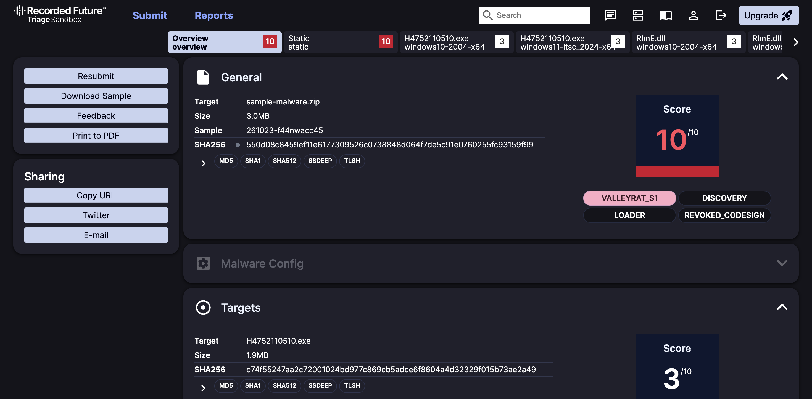

# WA-ZIP Cleaner

**English** | [Bahasa Melayu](README.md)

Someone sent you a zip file on WhatsApp (for example `Click here to view....zip`, `Notice.zip`, `PDF_C2841_20260911100446.zip`, `20261019-MYS2026Y1019E51AC.zip` or `101.zip`), and you opened it on a Windows laptop or PC? Stay calm. This free tool scans your PC, and if the malware is there, it removes it.

If you opened it on a phone (Android, iPhone) or a Mac, you are safe. This malware only attacks Windows.

One catch: if your phone auto-saves the file to **Google Drive** (or another cloud drive), and your PC syncs with that same drive, the file lands on the PC. If anyone double-clicks it there, the PC is infected.

## Is this really malware?

Yes, this is not a guess. We uploaded the file to two websites whose job is checking malware. Both say it is dangerous:

| VirusTotal: 18 antivirus engines flag it as malicious | Hatching Triage: score 10/10 |
|---|---|
|  |  |

The malware is called **ValleyRAT** (also known as Winos 4.0 or Silver Fox). Once it is on a PC, the attacker can steal your passwords, switch off your antivirus, and control the PC remotely as if they were sitting in front of it.

## Step 1: Run a Windows Defender full scan

Defender is the antivirus that already comes with Windows. Nothing to download.

1. Press the **Start** button (Windows logo, bottom left of the screen).
2. Type `Windows Security`. When it appears, click it.
3. Click **Virus & threat protection** (shield icon).
4. Click **Scan options** (blue text under the Quick scan button).
5. Choose **Full scan**, then click **Scan now**.
6. Wait. Usually 30 minutes to 2 hours. You can keep using the PC while it runs.
7. If Defender finds anything, click **Start actions** or **Remove**.

## Step 2: Scan with this tool (copy and paste one line)

Defender does not always catch this malware, because it uses legitimate programs to fool antivirus. The October version even tells Defender to ignore it, so a scan looks clean when it is not. This tool looks for the traces of this specific WhatsApp malware, including that "ignore" setting, and removes them all.

> **Be careful:** some attackers trick victims into pasting commands into PowerShell to install malware. Do not paste commands from people you do not know. The command below only fetches files from this project's official GitHub (`waz.afuit.dev` redirects straight to the [`run.ps1`](run.ps1) file in this repo), and the code is open for anyone to check. If in doubt, show this page to an IT person you trust and ask them to do it for you.

**A. Open an admin window**

1. On the keyboard, hold the **Windows** key (Windows logo), then press **X**. A menu opens at the bottom left.
2. In that menu, click **Terminal (Admin)**. On Windows 10 it is called **Windows PowerShell (Admin)**.
3. A box asks "Do you want to allow this app to make changes to your device?". Click **Yes**.
4. A black or blue window opens with some text and a blinking cursor. This is where you paste the command.

**B. Paste the command**

5. Press the **copy** button at the right end of the box below (or highlight all the text in the box and press **Ctrl + C**):

```powershell
irm waz.afuit.dev | iex
```

<details><summary>Short command not working? Use this long one</summary>

```powershell
[Net.ServicePointManager]::SecurityProtocol="Tls12"; $p="$env:TEMP\waz.ps1"; iwr https://raw.githubusercontent.com/afu-it/wa-zip-cleaner/main/wa-zip-cleaner.ps1 -OutFile $p; powershell -ExecutionPolicy Bypass -File $p; if ($LASTEXITCODE -eq 1 -and (Read-Host "Taip Y dan Enter untuk bersihkan") -eq "Y") { powershell -ExecutionPolicy Bypass -File $p -Fix }
```

</details>

6. Click once inside the black/blue window. Press **Ctrl + V** (or right-click) to paste.
7. Press **Enter**.

The tool talks in Malay first, with the English version in grey right below each line.

**C. Answer the question**

8. The tool asks: *is this PC/laptop managed by your office, or your own?*
   - A PC/laptop your office gave you, managed by an IT team: type `1`, press **Enter**.
   - Your own PC/laptop: type `2`, press **Enter**.
   - Not sure: just press **Enter**.
9. The scan starts. Wait 2 to 10 minutes. Do not close the window. You will see eight rows, `[1/8]` to `[8/8]`, each ending in a coloured label.

**D. Read the result**

10. Look at the **KEPUTUSAN (RESULT)** section at the bottom:
    - **BERSIH** (green, means CLEAN): the tool did not find this malware. You can close the window.
    - **AMARAN** only (yellow, means WARNING): the tool removes nothing. Read the yellow text and follow its advice. If it mentions **ManageEngine** and this is an office PC, show the screen to your office IT. If it mentions a **Remote-control program** (for example AnyDesk, TeamViewer) that you never installed, remove that program (see *Programs that cannot be uninstalled* below).
    - **BAHAYA** (red, means DANGER): at the very bottom you see *Taip Y dan Enter untuk bersihkan* (type Y and Enter to clean). Type `Y`, press **Enter**, go to step 11. Chrome, Edge or other browsers close by themselves, because the tool logs WhatsApp Web out on this PC. Open them again when it is done (if you are reading this guide in a browser, reopen this page).
11. Wait until you see **Kuarantin siap** (quarantine done). Bad files are not deleted outright. The tool moves them to `C:\WAZipQuarantine`, so anything removed by mistake can be restored.
12. **Restart the PC** (Start > Power > Restart).
13. When the PC is back on, do Step 2 again from the start, until it shows **BERSIH**.

### Missed the Y question?

If you pressed **Enter** without typing `Y`, the tool removed nothing. Do not type `y` on its own; PowerShell will not understand it. Paste this line into the same window and press **Enter**:

```
powershell -ExecutionPolicy Bypass -File $env:TEMP\waz.ps1 -Fix
```

### The tool says "Windows would not let the tool remove" or "ManageEngine is NOT fully removed"?

Some ManageEngine parts (for example `MEARWService`) protect themselves. While Windows is running, even an admin cannot remove them, even after a restart. So we remove them while Windows is not running. No need to reinstall Windows.

After you type `Y`, the tool asks you to pick:

- **Type `1`** (automatic Safe Mode, recommended): the PC restarts into Safe Mode, the tool removes everything, then restarts into normal Windows. **Do not touch anything.** Only type your Windows account **password** (not PIN) when Safe Mode asks.

**If Safe Mode is not enough** (the tool tells you), follow these blue recovery screen steps:

1. Before the restart, take a photo of the red text with your phone.
2. On the blue screen, click **Troubleshoot** > **Advanced options** > **Command Prompt**.
3. If asked, pick your account and enter the PC password. If it asks for a **BitLocker recovery key**, open `account.microsoft.com/devices/recoverykey` on your phone.
4. In the black window, type this and press **Enter**:
   ```
   C:\WAZipQuarantine\BUANG.bat
   ```
   If you get *not recognized*, try `D:\WAZipQuarantine\BUANG.bat`.
5. Wait until you see **SIAP** (done). It lists what it switched off (*Dimatikan*), moved (*Dialih*) and deleted (*Dibuang*). Everything is backed up first to `C:\WAZipQuarantine\winre`.
6. Type `exit`, press **Enter**, choose **Continue**.
7. Once Windows is up, do Step 2 again from the start, type `Y`, until it shows **BERSIH**.

Want to do it yourself without waiting for the tool to ask? Go to **Settings > System > Recovery > Advanced startup > Restart now**, then start from step 2 above. The `BUANG.bat` file only exists after the tool has tried to clean (you typed `Y`) and was blocked.

If the PC gets stuck in Safe Mode after choosing `1`: open the blue recovery screen (steps 2 and 3 above), type `bcdedit /deletevalue {default} safeboot`, press **Enter**, then `exit` > **Continue**.

**BERSIH does not prove the PC is safe.** The attacker can change this malware at any time, and this tool only knows the versions we have taken apart. If you really did open the file on a PC, still do the password steps below. If in doubt, ask an IT person to check.

## If you opened the file on a PC, also do this

This malware can sit quietly on a PC for weeks while stealing data. So even if the tool shows BERSIH or has removed it, assume your passwords have leaked.

Use your **phone**, not the infected PC:

1. WhatsApp > **Linked devices** > log out all. This stops the attacker from using your WhatsApp to send the bad file to your friends.
2. Change the password of **every account you ever logged into or saved in Chrome or Edge** on that PC. Start with online banking, email, Google, Microsoft and Facebook.
3. In each of those accounts, log out all other devices and turn on **2FA** (a verification code from your phone).
4. If there was bank information on the PC, call your bank and ask them to watch your account.

Then, for the PC:

1. Restart the PC, then do Step 2 again until it shows **BERSIH**.
2. If the tool warned about **ManageEngine** (and your office never installed it), or found a **driver** that switches off antivirus, the safest way: back up only your important files (documents, photos), then **reinstall Windows**. If you are not sure how, take it to a computer shop and say the PC was infected with remote-access malware.
3. When backing up, do not copy `.exe`, `.zip`, `.dll`, `.bat`, `.vhd` or `.vhdx` files. Only copy files you recognise.

If you never opened the file on a PC, and this tool shows **BERSIH**, you do not need to do any of this.

## Cleaned the PC (or reinstalled Windows), but WhatsApp still sends the file by itself?

This is not because the PC is still infected. While the malware was on the PC, the attacker stole the login keys (sessions) for WhatsApp Web, Gmail and other accounts from the browser. Those keys are now in the attacker's hands, not on your PC. That is why reinstalling Windows or deleting cookies on your own PC does not help. The attacker can still use the keys they copied. They have to be shut off from the account side.

Do this in order, using your **phone**:

1. **Log out every Linked device.** WhatsApp > three dots (Android) or Settings (iPhone) > **Linked devices**. Tap each device > **Log out**. Do it for all of them, including the ones you recognise.
2. **Turn on Two-step verification.** WhatsApp > Settings > Account > **Two-step verification** > Turn on. Set a 6-digit PIN the attacker cannot guess. This stops the attacker registering your number on their phone.
3. **Shut Gmail off from the Google side.** If your passwords were saved in Google (Google Password Manager), the attacker may have all of them. Open [myaccount.google.com](https://myaccount.google.com) > **Security** > **Your devices** > sign out every device you do not use. Then change your Google password and turn on **2-Step Verification**.
4. **Change the passwords saved in Google or Chrome**, starting with banking and email. In each account, look for **Log out all sessions** or **Sign out everywhere**.
5. **Do not link WhatsApp Web again** on any PC until that PC shows **BERSIH** with this tool.

If one WhatsApp number is used on several PCs (common in shops or offices), scan every one of those PCs. One infected PC is enough for the attacker to steal the session.

**If you did all of this and WhatsApp still sends the bad file:** the last resort is to delete the WhatsApp account and register again with the same number. All old sessions are gone for good. The cost is that your chats, groups and settings are lost, so back up important chats and contacts first, and tell customers or friends you re-registered. How: WhatsApp > Settings > Account > **Delete account**, then reinstall WhatsApp and register with the same number.

### WhatsApp number banned?

This malware sends the file to every contact and group at once. WhatsApp sees that as spam, so the victim's number often gets **banned** (a message says the account is not allowed to use WhatsApp). If that happens:

1. **Clean the PC first** with this tool until it shows **BERSIH**. Otherwise, once the account is reopened, it spams again and gets banned again.
2. Open WhatsApp on your phone. On the ban screen, tap **Request a review** (or **Support**).
3. Write briefly: your account was hacked by malware from a WhatsApp zip file, you did not send those messages, and the PC has been cleaned.
4. Wait for WhatsApp to reply. Usually a few hours to a few days. Do not send the review many times.
5. Meanwhile, tell customers and friends by SMS, phone call or social media: do not open zip files from your number.

Once the account is reopened, do steps 1 to 5 above straight away (log out Linked devices, turn on Two-step verification).

### Antivirus says "clean", but something still feels wrong?

Regular antivirus, Malwarebytes and VirusTotal **often miss** this malware. MyCERT itself says a regular antivirus scan does not remove the remote-control program (ManageEngine) the attacker installs. So a "clean" result from antivirus is not enough. Use this tool, and if you are still unsure, reinstall Windows.

Other signs the PC is infected: the PC freezes for a minute after opening the file, the file cannot be deleted because it is "still running", or WhatsApp starts sending zips by itself **two or three days later**.

**Report to MyCERT (Cyber999, Malaysia):** email cyber999@cybersecurity.my, phone 1-300-88-2999, or +60 19 266 5850 (24 hours). Include a screenshot of the message, the time it arrived, and the sender's number. Reference: [MyCERT MA-1464.062026](https://mycert.org.my/portal/advisory?id=MA-1464.062026).

---

More information below. Click a title to open it.

<details>
<summary><b>How to recognise this bad file (before opening it)</b></summary>

The file name keeps changing. Names people have seen: `Click here to view....zip`, `Notice.zip` (containing `Notice.vhd`), `PDF_C2841_20260911100446.zip` and `DOC_7748_20260924152821.zip`, `PDF_EXZ12S_20261022110417.zip`, `20261019.MYS2026Y1019A7F2E.zip` (odd letters and numbers mixed with a date), `101.zip`, `.vbs` files like `Work Snapshot.vbs`, and files named like an account statement, invoice, receipt, purchase order, salary, claim, LHDN or KWSP. Some pretend to come from a government agency. In October there was a message like this: *"Kindly forward the attached Statement of Account to your Finance Manager for review. Please open it on a computer"*. Being told to open it on a computer is a warning sign. Kaspersky also found the same group sending `Statement of Account.zip`, `November Statement.zip` and `December Statement.zip`, containing programs posing as documents, such as `Review the file.exe` or `BillReceipt.exe`. A real document is never an `.exe`.

So do not memorise names. Recognise the behaviour:

1. A file you were not expecting, usually a `.zip`.
2. A short note telling you to open it **on a computer**. A real invoice or statement opens fine on a phone.
3. It comes from a friend or group you know, because their WhatsApp has been hacked.
4. If opened on a PC, Windows may ask "Do you want to open this file?" for a `.vhd` file. Press **Cancel**.

If in doubt, call the sender and ask whether they really sent it. Business documents should come by email or an official system, and you can ask for that.

OCBC and UOB banks have also warned: do not open `.vbs`, `.zip`, `.msi` or `.exe` files that come from WhatsApp.

**Tip: turn off auto-download in WhatsApp.** With auto-download off, files do not land on your phone by themselves, so they never reach Google Drive or your PC. How: WhatsApp > **Settings** > **Storage and data** > **Media auto-download**, then turn everything off (mobile data, Wi-Fi, roaming).

</details>

<details>
<summary><b>Scared of typing commands? Download and double-click instead</b></summary>

1. At the top of this page, press the green **Code** button, then **Download ZIP**.
2. Open the **Downloads** folder. Right-click the zip file > **Extract All** > **Extract**.
3. In the folder that appears, double-click **`MULA-SINI.bat`** ("start here").
   - Windows asks for permission: press **Yes**.
   - If you see "Windows protected your PC": press **More info**, then **Run anyway**. This is normal.
4. The tool asks office or personal PC: type `1` (office) or `2` (personal), press Enter.
5. Wait 2 to 10 minutes. If it shows **BAHAYA**, type `Y` and press Enter.
6. Do everything in "If you opened the file on a PC" above. After the restart, double-click `MULA-SINI.bat` again.

</details>

<details>
<summary><b>How does a PC get infected?</b></summary>

It usually goes like this:

1. A friend sends you the zip file on WhatsApp. In fact your friend's WhatsApp has been hacked, which is why it looks genuine.
2. You open it on a Windows PC. It appears as if a new USB drive was plugged in.
3. Inside is a program that looks legitimate. That program is tricked into running the malware. Because it looks legitimate, antivirus does not notice.
4. The malware hides in the Windows registry, not in a normal file, so it is hard to find by hand.
5. It switches off your antivirus.
6. It sets itself to start every time the PC starts. Then it tries to contact the attacker's server.

</details>

<details>
<summary><b>Want an AI (ChatGPT, Claude, Copilot) to guide you?</b></summary>

Copy all of this text and paste it into ChatGPT, Claude or Copilot:

```text
I think my Windows PC is infected with the WhatsApp "Click here to view.zip"
malware (Winos 4.0 / Silver Fox / ValleyRAT). I am not good with IT.

There is a free tool to remove this malware: https://github.com/afu-it/wa-zip-cleaner

Please teach me one step at a time, in simple language, how to:
1. Run that tool on Windows the easiest way.
2. Understand what BERSIH (clean) and BAHAYA (danger) mean.
3. Remove the malware if it is there.
4. What I must do afterwards (WhatsApp Linked devices, change passwords).

Do not tell me to reinstall Windows first. Ask one question at a time if needed.
```

</details>

<details>
<summary><b>What this tool cannot do</b></summary>

- It is not a full antivirus. It only looks for this particular WhatsApp malware. For a full scan, use Windows Defender, Kaspersky or Malwarebytes.
- It detects the **VHD** variant (the one we studied) and the **VBS** variant (Kaspersky reported it in Malaysia in June). Another variant uses **shortcuts (`.lnk`)**, called SORVEPOTEL, which Trend Micro found in Brazil. For example `malware-whatsapp.rar` containing `DOC-50998906_17774E7A.lnk`. The tool now catches such shortcuts if they are still on the PC, but not what they download afterwards. That is why you should also run a Windows Defender full scan.
- It knows the malware versions we found in October 2026. If the attacker changes it slightly, we have added broader detection, but we cannot promise 100%.
- Another victim found a data stealer called `888.exe` in the same campaign. It takes Chrome and Edge passwords and WhatsApp sessions. This tool does not detect `888.exe` yet. So if it shows BAHAYA, change every password even after the tool has cleaned the PC.
- The ManageEngine agent the attacker installs cannot be uninstalled the normal way, because it asks for a PIN only the attacker has. This tool can force-remove it (program, services, tasks, folders and the Apps entry), but only if you answer that the PC is your own, because some offices really do use ManageEngine. Everything removed is backed up. Removing ManageEngine does not mean the PC is clean, so still consider reinstalling Windows.
- We have not found the attacker's server address. The server may already be dead.

</details>

<details>
<summary><b>Programs that cannot be uninstalled (ManageEngine, AnyDesk and others)</b></summary>

If the tool warns about a remote-control program you never installed, and the normal uninstall asks for a PIN or password:

1. Download **Bulk Crap Uninstaller** from [bcuninstaller.com](https://www.bcuninstaller.com/). It is free and open source.
2. Open it and wait for the program list to load.
3. Search for the program name (for example *ManageEngine* or *AnyDesk*).
4. Right-click the name and choose **Uninstall manually**. It removes the files, services and registry entries without asking for a PIN.
5. Restart the PC, then run this tool again.

For ManageEngine it is easier: run this tool and answer **2** (personal PC). The tool force-removes it. You can also email ManageEngine support and tell them their account is being used by an attacker to control your PC, so they can shut that account down.

Some people suggest GMER to remove ManageEngine. We do not recommend it, because GMER has not been updated in a long time and does not suit Windows 11. Use this tool or Bulk Crap Uninstaller.

</details>

<details>
<summary><b>How we checked this malware</b></summary>

1. Opened the zip file on a separate computer, without running the malware.
2. Deliberately infected a Windows 11 VM (a computer inside a computer, with no internet), then ran this tool. It removed the malware and left normal files untouched.
3. Reverse-engineered the malware to understand how it hides.
4. Uploaded it to VirusTotal and Triage so others could confirm.

Every time the tool's code changes, automatic tests run on Windows to make sure it still works.

Full report: [docs/REPORT.md](docs/REPORT.md). Triage report: [tria.ge/261023-f44nwacc45](https://tria.ge/261023-f44nwacc45)

</details>

<details>
<summary><b>For IT people: manual use, restore, what is checked</b></summary>

Open PowerShell as Admin, `cd` to the repo folder, then:

```powershell
powershell -ExecutionPolicy Bypass -File .\wa-zip-cleaner.ps1        # scan only
powershell -ExecutionPolicy Bypass -File .\wa-zip-cleaner.ps1 -Fix   # quarantine
powershell -ExecutionPolicy Bypass -File .\wa-zip-cleaner.ps1 -Owner Personal -Fix   # personal PC: ManageEngine counts as HIGH and is removed
powershell -ExecutionPolicy Bypass -File .\wa-zip-cleaner.ps1 -Owner Office         # office PC: ManageEngine is only a warning
powershell -ExecutionPolicy Bypass -File .\wa-zip-cleaner.ps1 -RemoveManageEngine   # force-remove ManageEngine without asking
powershell -ExecutionPolicy Bypass -File .\wa-zip-cleaner.ps1 -Restore -Manifest "C:\WAZipQuarantine\<date>\manifest.json"
```

The `manifest.json` path is printed during `-Fix`. Exit codes: `0` clean, `1` danger found (HIGH), `2` error, `3` warnings only. Without `-Owner`, the tool asks office or personal at the start; a `-Fix` run within 2 hours reuses the same answer.

The tool knows 2 Silver Fox variants.

Variant 1 (we took it apart): VHD inside a zip, KafanInputService (signed) sideloads `rime.dll`, payload in registry `Console\0` runs fileless, BYOVD driver (ZyArk/Baidu, ardrv/OPSWAT), persistence through a fake `hidserv.dll` service.

Variant 2 ([Pelagos Intel](https://research.pelagos-intel.com/silverfox-in-the-desktop)): IMG inside a zip, KuGou `active_desktop_launcher.exe` (signed) loads `active_desktop_render_x64.dll`, staging in `%APPDATA%\Microsoft\Update\`, Run value `MicrosoftUpdate`, C2 `134.122.155.135:443`.

| # | Check | Examples |
|---|---|---|
| 1 | Process | `rundll32 ...,_vmclientcore@16`, fake `rime.dll` outside Program Files |
| 2 | VHD | `Click here to view*.vhd` |
| 3 | Registry | `Console\0` (32-hex value name), `Console\IpDate`, `IpDates_info`, `Magisk`, `FaCai2024` |
| 4 | Drivers / services | `ZyArk`, `ardrv`; services that launch a script interpreter from a user folder; every kernel driver hashed against the [LOLDrivers](https://www.loldrivers.io) list (`data/loldrivers.csv`, ~2,200 hashes: malicious = HIGH, vulnerable = warning); Microsoft Vulnerable Driver Blocklist switched off (warning) |
| 5 | Autostart & Defender | Run keys (including ones pointing to Hidden+System files, and `MicrosoftUpdate` to `%APPDATA%\Microsoft\Update\`), scheduled tasks (including hidden tasks running `Add-MpPreference`), Startup folder; Defender exclusions for `svchost.exe`, `QtsUpdater.exe` and other system programs |
| 6 | Files | known SHA-256, lure names (`Click here to view*`, `Notice*.vhd`, `PDF_XXXXXX_<date>`, `<date>-MYS2026Y...`), payloads `eneio64.dat` / `plcc3a.dat`, other `.vhd`/`.vhdx` files in user folders (warning, except WSL), `hidserv.dll` outside System32, Hidden+System files, fake Visual C++ installers |
| 7 | Related RMM | ManageEngine UEMS agent from the WhatsApp VBS campaign (office PC: warning only; personal PC: HIGH and force-removed; also `-RemoveManageEngine`); other remote tools from the [LOLRMM](https://lolrmm.io) list (AnyDesk, TeamViewer, RustDesk, ToDesk, SunLogin, ScreenConnect, etc.: warning only) |
| 8 | Browsers | Chrome/Edge/Brave/Opera/Firefox: extensions force-installed by policy (personal PC: HIGH and removed; office/unsure: warning), browser shortcuts with `--load-extension` (HIGH), extensions loaded from a folder instead of the web store (warning). If the PC is infected (any HIGH), WhatsApp Web sessions (IndexedDB folder `web.whatsapp.com`) in every browser are quarantined so this PC is logged out; browsers are closed first |
| 9 | ABCDoor ([Kaspersky](https://securelist.com/silver-fox-tax-notification-campaign/119575/)) | folder `%LOCALAPPDATA%\appclient` (pythonw `-m appclient`), Run/task `AppClient`, `HKCU\Environment\UserInitMprLogonScript`, `HKCU\Software\CarEmu`, lure programs `Review the file.exe`/`BillReceipt.exe`/`GST Suvidha.exe` etc., connections to Silver Fox C2 IPs, and C2 domains in the DNS cache (warning) |
| 10 | Shortcuts (SORVEPOTEL) | `.lnk` files in user folders that run `cmd`/`powershell`/`mshta` with hidden commands (`-enc`, `for %x in`, `DownloadString`, `IEX`, URLs); domain `zapgrande.com` in the DNS cache |
| 11 | History | files in Downloads/Desktop/Documents that Windows marks as downloaded from `web.whatsapp.com` (programs, scripts, VHD/IMG/ISO = HIGH; zip/rar/7z are moved to quarantine on Y but do not count as infection); 30 days of Windows Defender logs (threat found, real-time protection off, exclusion added: warning); records of programs that ran (Windows 11 `PcaAppLaunchDic.txt` and Prefetch) with known malware names (warning). History from before the last clean-up is not reported again |

The LOLDrivers list is refreshed with `python3 tools/update-loldrivers.py`. When the script runs on its own (one-liner), it downloads `data/loldrivers.csv` from this repo; if that fails, the driver check is skipped.

Other useful tools for IT people:

- [PersistenceSniper](https://github.com/last-byte/PersistenceSniper): checks over 50 Windows autostart locations, good for finding anything this tool misses.
- [Elastic `Windows_Trojan_Winos.yar`](https://github.com/elastic/protections-artifacts/blob/main/yara/rules/Windows_Trojan_Winos.yar): Elastic's Winos YARA rule (Elastic licence, so we link it rather than copy it).
- [Bulk Crap Uninstaller](https://github.com/Klocman/Bulk-Crap-Uninstaller): force-uninstalls programs whose uninstaller asks for a PIN.

IOCs: [IOCS.md](IOCS.md), [docs/iocs.csv](docs/iocs.csv). YARA: [winos4-whatsapp.yar](winos4-whatsapp.yar). Tests run on Windows Server 2022 and 2025.

</details>

<details>
<summary><b>Want to help?</b></summary>

This project is free and open source. Anyone can help: developers, vibecoders, the Malaysian cybersecurity community.

- Found a new version of this malware? Open an [Issue](https://github.com/afu-it/wa-zip-cleaner/issues) with the hash or a VirusTotal/Triage link. Do not upload the malware file directly.
- Can code? Add detection to `wa-zip-cleaner.ps1` or a rule to `winos4-whatsapp.yar`, and open a Pull Request. Make sure the tests pass.
- Can write or design? Help improve this guide, translate it, or make a warning poster.
- Security person? Review [docs/REPORT.md](docs/REPORT.md), or share the IOCs to MalwareBazaar/ThreatFox.

</details>

## Licence

MIT. Free, but with no warranty. Use at your own risk.
