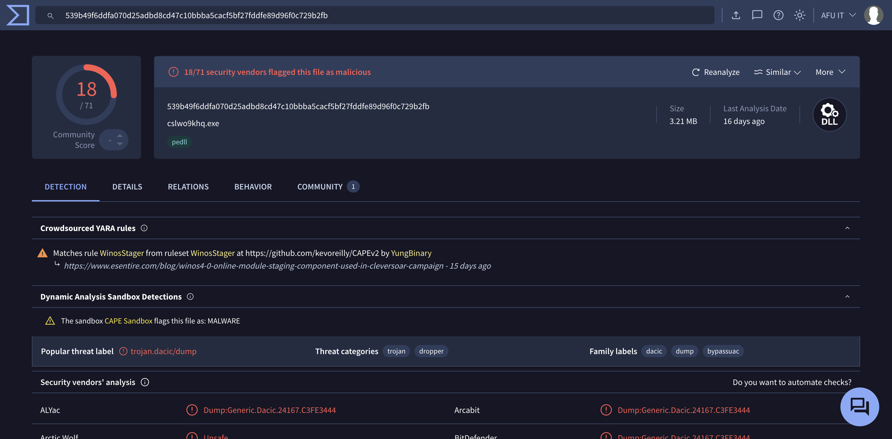
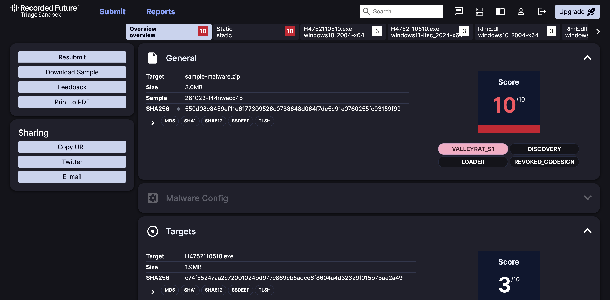

# WA-ZIP Cleaner

Ada orang hantar fail `Click here to view....zip` kat WhatsApp, and you terbuka kat laptop atau PC Windows? Relax. Tool free ni boleh check PC you, and kalau ada virus tu, dia buang terus.

Kalau you buka kat phone (Android, iPhone) atau Mac, takpe, you selamat. Virus ni cuma kacau Windows je.

## Betul ke ni virus?

Betul, ini bukan kami agak-agak je. Kami dah hantar fail tu ke dua website yang memang kerja dia check virus. Dua-dua cakap bahaya:

| VirusTotal: 18 antivirus cakap bahaya | Hatching Triage: markah bahaya 10/10 |
|---|---|
|  |  |

Virus ni nama dia **ValleyRAT** (ada orang panggil Winos 4.0 atau Silver Fox). Kalau dah masuk PC, orang jahat boleh curi password you, off antivirus you, and control PC you dari jauh macam dia duduk depan PC you.

## Cara buang (copy paste 1 line je)

1. Tekan **Windows + X** serentak kat keyboard. Satu menu keluar. Pilih **Terminal (Admin)** atau **Windows PowerShell (Admin)**. Kalau dia tanya, tekan **Yes**.
2. Satu kotak hitam/biru keluar. Copy line ni, paste dalam kotak tu (klik kanan dalam kotak tu = paste), lepas tu tekan **Enter**:

```powershell
[Net.ServicePointManager]::SecurityProtocol="Tls12"; $p="$env:TEMP\waz.ps1"; iwr https://raw.githubusercontent.com/afu-it/wa-zip-cleaner/main/wa-zip-cleaner.ps1 -OutFile $p; powershell -ExecutionPolicy Bypass -File $p; if ($LASTEXITCODE -eq 1 -and (Read-Host "Taip Y dan Enter untuk bersihkan") -eq "Y") { powershell -ExecutionPolicy Bypass -File $p -Fix }
```

3. Tunggu dalam 2 sampai 10 minit. Jangan tutup kotak tu. Pergi minum air dulu.
   - Keluar **BERSIH**: PC you okay, takde virus. Settle.
   - Keluar **BAHAYA**: taip `Y`, tekan Enter. Tool ni akan buang virus tu. Fail jahat tu dia pindah ke satu folder asing (`C:\WAZipQuarantine`), bukan delete terus, so kalau tersalah buang boleh ambil balik.

## Lepas dah buang, buat 3 benda ni

1. Buka WhatsApp kat **phone** > **Linked devices** (Peranti dipaut) > log out semua. Ni supaya orang jahat tak boleh baca WhatsApp you lagi.
2. Tukar password **online banking** and **email** you. Better guna phone untuk tukar.
3. Restart PC, lepas tu buat langkah "Cara buang" tadi sekali lagi sampai keluar **BERSIH**.

Tak payah format PC. Format cuma perlu kalau tool ni sendiri bagitau dia jumpa benda yang off antivirus. Kalau takde, tak payah.

---

Bawah ni info tambahan. Klik tajuk untuk buka.

<details>
<summary><b>Takut nak taip-taip? Cara download and double-click je</b></summary>

1. Kat atas page ni, tekan butang hijau **Code**, pastu **Download ZIP**.
2. Buka folder **Downloads**. Klik kanan fail zip tadi > **Extract All** > **Extract**.
3. Dalam folder yang keluar, double-click fail **`MULA-SINI.bat`**.
   - Windows tanya boleh ke tak: tekan **Yes**.
   - Kalau keluar "Windows protected your PC": tekan **More info**, pastu **Run anyway**. Ni normal.
4. Tunggu 2 sampai 10 minit. Kalau keluar **BAHAYA**, taip `Y` and tekan Enter.
5. Buat 3 benda dalam "Lepas dah buang" kat atas. Lepas restart, double-click `MULA-SINI.bat` sekali lagi.

</details>

<details>
<summary><b>Macam mana boleh kena?</b></summary>

Biasanya jadi macam ni:

1. Kawan you hantar fail zip tu kat WhatsApp. Sebenarnya WhatsApp kawan you tu yang dah kena hack, sebab tu nampak macam betul.
2. You buka kat PC Windows. Dia keluar macam ada satu pendrive baru masuk.
3. Dalam tu ada satu program yang nampak legit. Program tu kena tipu untuk jalankan virus. Sebab nampak legit, antivirus pun tak perasan.
4. Virus tu sorok dalam setting Windows, bukan dalam fail biasa. So susah nak jumpa kalau cari sendiri.
5. Dia off antivirus you.
6. Dia set supaya setiap kali PC hidup, dia hidup sekali. Lepas tu dia cuba contact orang jahat tu.

</details>

<details>
<summary><b>Nak suruh AI (ChatGPT, Claude, Copilot) tolong ajar?</b></summary>

Copy semua ayat ni, paste dalam ChatGPT, Claude atau Copilot:

```text
Saya rasa komputer Windows saya terkena virus WhatsApp "Click here to view.zip"
(jenis Winos 4.0 / Silver Fox / ValleyRAT). Saya tak pandai IT.

Ada tool free untuk buang virus ni: https://github.com/afu-it/wa-zip-cleaner

Tolong ajar saya satu langkah satu masa, guna bahasa senang, untuk:
1. Jalankan tool tu kat Windows dengan cara paling senang.
2. Faham apa maksud BERSIH dan BAHAYA.
3. Buang virus kalau ada.
4. Apa saya kena buat lepas tu (WhatsApp linked devices, tukar password).

Jangan suruh saya format Windows dulu. Tanya satu soalan satu masa kalau perlu.
```

</details>

<details>
<summary><b>Apa yang tool ni tak boleh buat</b></summary>

- Ni bukan antivirus penuh. Dia cuma cari virus WhatsApp yang ni je. Kalau nak check semua, guna Kaspersky atau Malwarebytes.
- Dia kenal versi virus yang kami jumpa bulan Oktober 2026. Kalau orang jahat ubah sikit, kami dah tambah cara cari yang lebih umum, tapi tak boleh janji 100%.
- Kalau dia jumpa benda yang off antivirus, cara paling selamat tetap backup data and install semula Windows. Tool ni akan bagitau kalau perlu.
- Kami belum jumpa alamat server orang jahat tu. Mungkin server tu dah tutup.

</details>

<details>
<summary><b>Macam mana kami check virus ni</b></summary>

1. Bukak fail zip tu dalam komputer berasingan, tanpa jalankan virus tu.
2. Sengaja jangkitkan satu Windows 11 palsu (komputer dalam komputer, tak sambung dengan apa-apa), pastu jalankan tool ni. Dia berjaya buang virus tu, and fail biasa tak terusik.
3. Bedah virus tu untuk faham macam mana dia sorok diri.
4. Hantar ke VirusTotal and Triage untuk orang lain sahkan.

Setiap kali code tool ni berubah, ada ujian auto yang jalan kat Windows untuk pastikan dia masih jalan elok.

Report penuh: [docs/REPORT.md](docs/REPORT.md). Report Triage: [tria.ge/261023-f44nwacc45](https://tria.ge/261023-f44nwacc45)

</details>

<details>
<summary><b>Untuk orang IT: cara manual, restore, apa yang di-check</b></summary>

Buka PowerShell as Admin, `cd` ke folder repo, then:

```powershell
powershell -ExecutionPolicy Bypass -File .\wa-zip-cleaner.ps1        # scan je
powershell -ExecutionPolicy Bypass -File .\wa-zip-cleaner.ps1 -Fix   # quarantine
powershell -ExecutionPolicy Bypass -File .\wa-zip-cleaner.ps1 -Restore -Manifest "C:\WAZipQuarantine\<tarikh>\manifest.json"
```

Path `manifest.json` keluar masa `-Fix`. Exit code: `0` bersih, `1` ada jumpa, `2` error.

Infection chain: VHD dalam zip, KafanInputService (signed) sideload `rime.dll`, payload dalam registry `Console\0` jalan fileless, BYOVD driver (ZyArk/Baidu, ardrv/OPSWAT), persistence guna servis palsu `hidserv.dll`.

| # | Check | Contoh |
|---|---|---|
| 1 | Process | `rundll32 ...,_vmclientcore@16`, `rime.dll` palsu luar Program Files |
| 2 | VHD | `Click here to view*.vhd` |
| 3 | Registry | `Console\0` (value name 32-hex), `Console\IpDate`, `IpDates_info`, `Magisk`, `FaCai2024` |
| 4 | Driver / servis | `ZyArk`, `ardrv`; servis yang launch script interpreter dari user folder |
| 5 | Autostart | Run keys (termasuk yang point ke fail Hidden+System), scheduled task, Startup folder |
| 6 | Fail | SHA-256 dikenali, nama umpan, `hidserv.dll` luar System32, fail Hidden+System, installer Visual C++ palsu |
| 7 | RMM berkaitan | agent ManageEngine UEMS dari kempen VBS WhatsApp (warning je) |

IOC: [IOCS.md](IOCS.md), [docs/iocs.csv](docs/iocs.csv). YARA: [winos4-whatsapp.yar](winos4-whatsapp.yar). Tests jalan kat Windows Server 2022 and 2025.

</details>

<details>
<summary><b>Nak tolong?</b></summary>

Projek ni free and open source. Sesiapa pun boleh tolong, dev, vibecoder, orang cybersecurity Malaysia.

- Jumpa versi baru virus ni? Buka [Issue](https://github.com/afu-it/wa-zip-cleaner/issues), bagi hash atau link VirusTotal/Triage. Jangan upload fail virus terus.
- Reti code? Tambah detection dalam `wa-zip-cleaner.ps1` atau rule dalam `winos4-whatsapp.yar`, buka Pull Request. Pastikan test lulus.
- Reti tulis atau design? Tolong baiki panduan ni, translate, atau buat poster amaran.
- Orang security? Semak [docs/REPORT.md](docs/REPORT.md), atau share IOC ke MalwareBazaar/ThreatFox.

</details>

<details>
<summary><b>English</b></summary>

Free scanner and cleaner for Windows PCs that opened the WhatsApp `Click here to view*.zip` malware (ValleyRAT / Winos 4.0 / Silver Fox). Phones and Macs are not affected.

Press **Windows + X**, open **Terminal (Admin)**, paste the command from the top of this page, and press Enter. If it finds something, type `Y` to quarantine it.

Or download the repo, extract it, and double-click `MULA-SINI.bat`.

After cleaning: log out of WhatsApp linked devices, change bank and email passwords, restart, and scan again. Full analysis: [docs/REPORT.md](docs/REPORT.md).

</details>

## Lesen

MIT. Free, tapi takde jaminan. Guna atas risiko sendiri.
