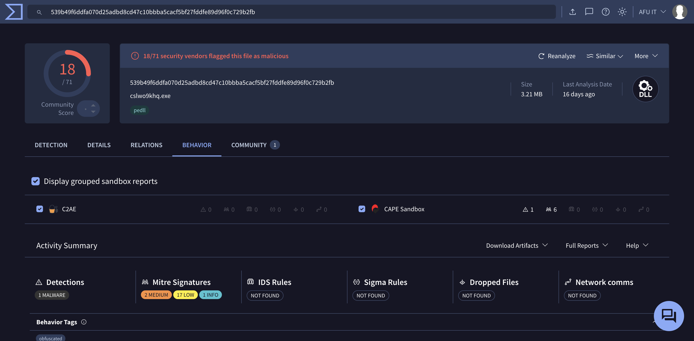
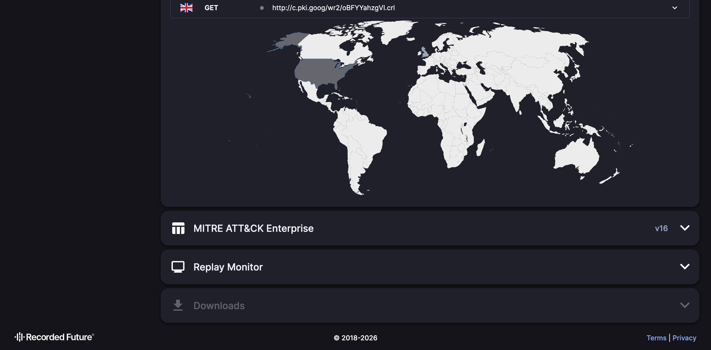

# Analysis Report — WhatsApp "Click here to view*.zip" Malware (Winos 4.0 / Silver Fox / ValleyRAT)

**Date:** 2026-10-23 · **Campaign:** Winos 4.0 online-module staging ("CleverSoar"-style), delivered via WhatsApp in Malaysia.

This report backs the detection and cleanup logic in [`wa-zip-cleaner.ps1`](../wa-zip-cleaner.ps1) and the rules in [`winos4-whatsapp.yar`](../winos4-whatsapp.yar). All findings below were reproduced on real infections.

---

## Summary

Victims receive a WhatsApp message with a ZIP named like `Click here to view10.6.zip`. The ZIP contains a VHD that auto-mounts as a drive; inside it, a **validly-signed** `KafanInputService.exe` side-loads a malicious `RImE.dLl` (Winos 4.0 stager). The stager hides its payload in the registry (`HKCU\Console\0`), runs it from executable memory (fileless), drops **signed-but-abused drivers** (ZyArk/Baidu, ardrv/OPSWAT) to disable antivirus, and persists as a fake Windows service (`hidserv.dll`).

- **Family (confirmed):** ValleyRAT / Silver Fox / Winos 4.0
- **Triage score:** 10/10 malicious
- **C2 address:** not recoverable (see below)

---

## Third-party confirmation

### VirusTotal — stager detection
18/71 vendors flag it. Crowdsourced YARA rule **`WinosStager`** (CAPEv2) matches; eSentire ties it to the Winos 4.0 online-module staging ("CleverSoar") campaign. CAPE Sandbox: MALWARE. Threat label `trojan.dacic/dump`.

### VirusTotal — behavior

### Hatching Triage — overview (score 10/10, `VALLEYRAT_S1`)
Public report: https://tria.ge/261023-f44nwacc45

### Triage — network (benign traffic only, no C2)
Across all 5 detonations the sample made only benign traffic (Google cert checks `c.pki.goog`, DNS `8.8.8.8`). Triage's "Malware Config" came back **empty**.

---

## Kill chain

1. **Lure:** WhatsApp ZIP `Click here to view*.zip` → contains a VHD.
2. **Auto-mount:** opening the VHD mounts it as a drive.
3. **Signed side-load:** `KafanInputService.exe` (signed, now **revoked**) imports `rime.dll` and loads the malicious `RImE.dLl` from the same folder → AV trusts the signed host.
4. **Fileless payload:** stager stores `[0xA44 header][shellcode]` in `HKCU\Console\0`, copies it into `VirtualAlloc(PAGE_EXECUTE_READWRITE)` and runs it.
5. **AV kill (BYOVD):** decrypts RC4-encrypted drivers from its resources — `ZyArk.sys` (Baidu BdArKit) and `ardrv.sys` (OPSWAT) — to disable protection from kernel mode.
6. **Persistence:** fake `hidserv.dll` registered as a "Human Interface Device Service"; `HKCU\...\Run` entries; scheduled task; self-relaunch via `rundll32 ...,_vmclientcore@16`.
7. **Second stage:** downloads a payload disguised as `dd_vcredist_x86_*_vcRuntimeMinimum_x86.exe`.

### Reverse engineering notes
- Cipher: **RC4**. Driver-resource RC4 key (recovered): `335D0F051BA4D8B0E57DDC7F66EEB5D9`.
- Main body lives in the `.输入` section and is control-flow obfuscated.
- Mutex: `7D29FD842A3F8A91A6A69DD152086C2A`.

---

## Why the C2 was not recovered

The C2 address lives inside the encrypted, runtime-only second-stage config. It could not be extracted by **any** of: a local ARM Windows VM (sample crashes), speakeasy emulation (breaks on obfuscation), Wine+FEX on ARM (anti-analysis halts it after `WSAStartup`), static RE (obfuscated), or **Hatching Triage's real x86 cloud sandbox** (config empty, benign traffic only). The most likely cause is that the **C2 server is already dead/taken down**, so connection attempts fail silently. The cleaner and YARA rules do not depend on the C2.

---

## Indicators of Compromise (IOC)

| Type | Value |
|---|---|
| Lure ZIP (SHA-256) | `550d08c8459ef11e6177309526c0738848d064f7de5c91e0760255fc93159f99` |
| Stager `RImE.dLl` (SHA-256) | `539b49f6ddfa070d25adbd8cd47c10bbba5cacf5bf27fddfe89d96f0c729b2fb` |
| Side-load host `KafanInputService.exe` | `c74f55247aa2c72001024bd977c869cb5adce6f8604a4d32329f015b73ae2a49` |
| `hidserv.dll` (persistence) | `2da61980a54cf44081a111e319ee7ab2165743383a4dbb0dca811389779721ba` |
| Encrypted config `.dat` | `12b9470634bb7f76419c70ee9a510147cd6bcfce920f2abee5afdd13901b383d` |
| `ZyArk.sys` (AV killer, Baidu) | `46883bc25c77678f60c1b836f4c438d87158c9af6b229f533522f635a0d5276e` |
| `ardrv.sys` (AV killer, OPSWAT) | `1c5129b4d63f2d5252b5b02a0a7d655dac3b6eac23dd4ed92b4dd55f243387ff` |
| Filenames | `Click here to view*.zip` / `*.vhd`, `hidserv.dll` outside System32, `dd_vcredist_x86_*_vcRuntimeMinimum_x86.exe` |
| Registry | `HKCU\Console\0` (32-hex value name), `Console\IpDate`, `Software\IpDates_info` |
| Services | `ZyArk`, `ardrv` (outside OPSWAT folder) |
| Process | `rundll32 ...,_vmclientcore@16` |
| Mutex | `7D29FD842A3F8A91A6A69DD152086C2A` |

---

## References
- eSentire: Winos 4.0 online module staging component used in CleverSoar campaign.
- Triage public report: https://tria.ge/261023-f44nwacc45
